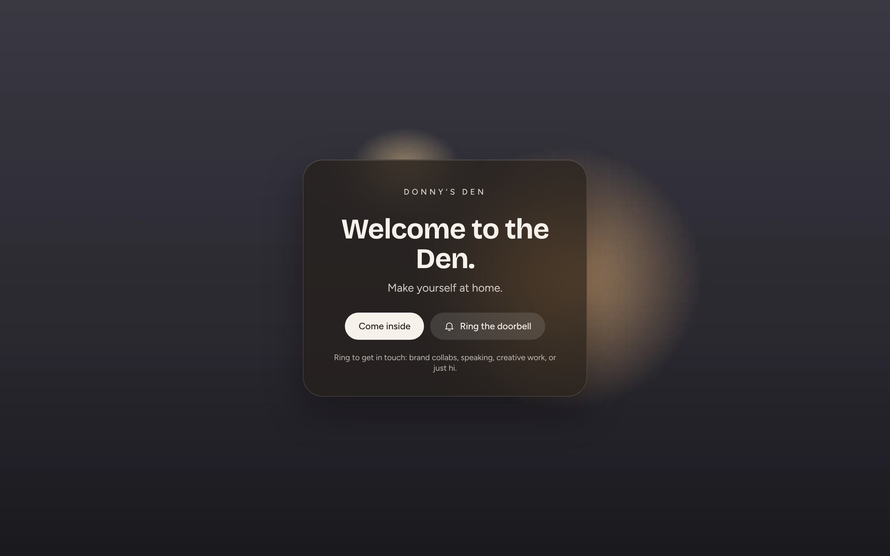
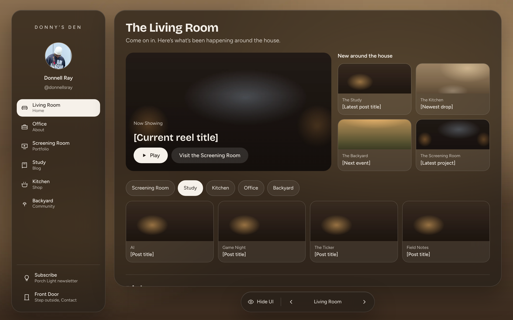
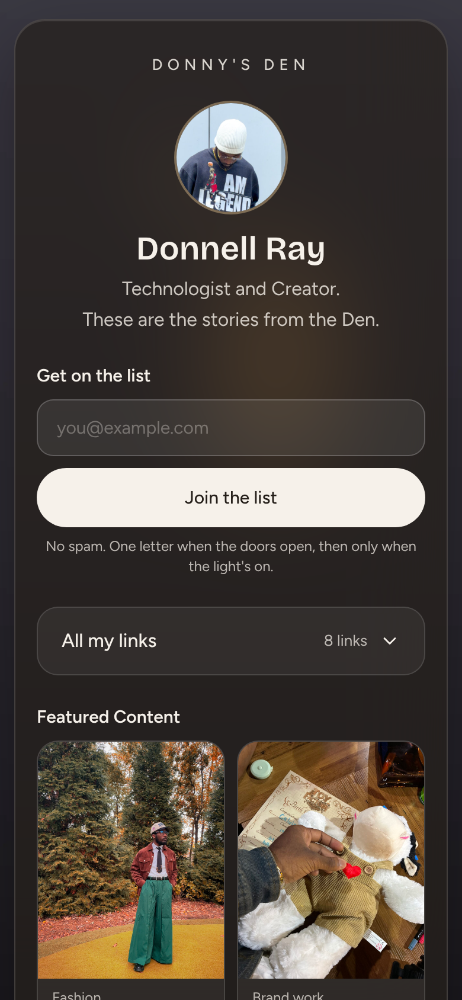
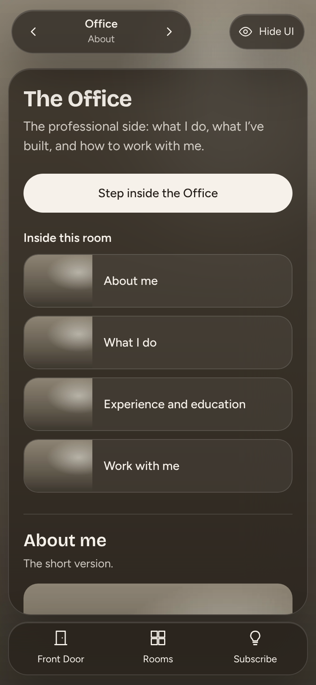
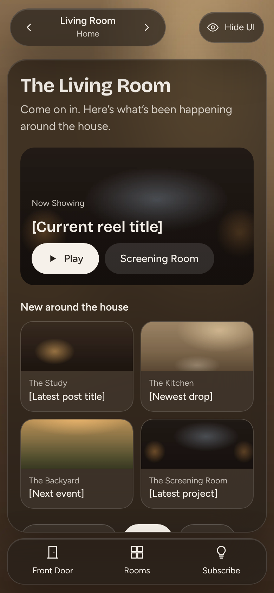

# Donny's Den

**A personal website designed as a house you walk through, built with AI.**

You knock at the **Front Door**, step inside, and move room by room: the Living Room for what's new, the Office for my professional side, the Screening Room for my work, the Study for writing, the Kitchen for things I make, and the Backyard for community. A separate **Links** page works as my link in bio and a mini portfolio.

I directed the project and made the decisions; [Claude Code](https://claude.ai/code) did the building on a live WordPress site through MCP. This repo is the case study: what was built, how, and the code behind it.

<p>
  
  
</p>

> **Status:** in progress. Visitors currently see a "The Den opens soon" page with an email signup. The [links page](https://donnysden.1wp.site/links/) is live.

## The project at a glance

| | |
| --- | --- |
| **Role** | Concept, content, art direction and decisions: Donnell Ray. Build: Claude Code (AI) |
| **Timeline** | Oct 1 to Nov 11, 2026, over 5 working days (see [timeline](#timeline)) |
| **Hands-on time** | _TBD_ |
| **Pages** | Front Door, 6 rooms, Links, Coming Soon |
| **Custom code** | ~370 lines, all in 3 Elementor Custom Code snippets ([`snippets/`](snippets/)) |
| **Plugins added** | 1 (Advanced Custom Fields) |

## Screens

| Phone | | |
| --- | --- | --- |
|  |  |  |
| Links: photo, signup, "All my links", Featured Content | Office: the professional About page | Living Room with the mobile shell |

More in [`screenshots/`](screenshots/): Coming Soon, Screening Room, the Links page with its link list open, and Featured Content.

## What's in the house

| Room | Path | What it holds |
| --- | --- | --- |
| Front Door | `/` | The entrance. "Come inside" fades into the Living Room |
| Living Room | `/living-room/` | Now Showing, what's new around the house, Right now, and all my links |
| Office | `/about/` | Professional about: bio, what I do, experience and education, work with me |
| Screening Room | `/portfolio/` | Portfolio |
| Study | `/blog/` | Blog |
| Kitchen | `/shop/` | Shop |
| Backyard | `/community/` | Community, Discord and events |
| Links | `/links/` | Link in bio plus **Featured Content**, a portfolio grid fed by WordPress Projects |

## Design

- **Look:** glass panels over warm "porch light" scenes, in the spirit of visionOS. Headlines are set in Bricolage Grotesque and body text in Figtree.
- **Shell:** a fixed sidebar, room window and floating control pill on desktop, and a top bar, bottom bar and Rooms sheet on phones. Prev and next arrows walk the rooms in menu order.
- **Rule one:** everything I'd edit later (text, buttons, links, images, room labels) stays editable in Elementor. Custom CSS and JS are only for the shared shell and its interactions, and they live in one place.
- **Accessibility:** dialogs with focus traps and Escape, real buttons with ARIA states, skip link, reduced-motion support, 44px tap targets, and 4.4:1 or better text contrast on glass.

## Stack

| | Version | Used for |
| --- | --- | --- |
| WordPress | 7.1 | CMS (multisite network with one site) |
| Hello Elementor | 3.5.1 | Lightweight base theme |
| Elementor | 4.4.0 | v4 atomic elements, Global Classes, Custom Code |
| Elementor Pro | 4.3.1 | Theme Builder shell, Loop Grid, Forms, Popups, Coming Soon mode |
| Advanced Custom Fields | 6.8.11 | `project` post type and fields for the portfolio |
| Novamira + Novamira Pro | 1.12 / 1.6 | MCP server that let Claude read and edit the site |
| xSpeed Cache | 1.4.7 | Page cache (xCloud) |
| Hosting | | xCloud, LiteSpeed, PHP 8.3 |
| AI | | Claude Code (cloud session) |

## How it was built with AI

1. **Brief first.** I wrote the concept, rooms, ground rules and quality bar, and shared a clickable prototype.
2. **Claude Code connected to WordPress** through the Novamira MCP server. It worked on the real site through structured "abilities" (create pages, set Elementor content, manage global classes, run PHP checks) rather than by pasting code into an editor.
3. **Pages were generated as data.** Small Python builders describe each room as an Elementor element tree, with shared helpers for glass panels, buttons and tiles, and push it to the site ([`builders/`](builders/)).
4. **Every change was verified.** After each step Claude took headless-browser screenshots at phone and desktop sizes, tested keyboard behavior, checked for console errors and sideways scroll, and ran Lighthouse.
5. **One decision at a time.** I approved each phase, supplied the content (links, bio, projects, photos) and steered the design. Claude kept a running [build log](docs/BUILD-LOG.md).

## Timeline

| Date (2026) | Milestone |
| --- | --- |
| Oct 1 | Claude Code connected to the site over MCP |
| Oct 6 | Full first pass: styles, shell, Front Door, 7 rooms, interactions, QA, "Come inside" entrance, Coming Soon page with signup |
| Oct 7 | Font change to Bricolage Grotesque + Figtree |
| Oct 8 | Office became the professional About page; Hallway folded into the Living Room |
| Nov 11 | Links page with Featured Content; profile photo; this repo |

## Results

- 8 pages pass at 1440, 1280, 1024, 768 and 390px: no sideways scroll, no script errors.
- Lighthouse (mobile): **100 accessibility** and **100 best practices**; performance 70–86. SEO is held at 61 only because search engines are blocked before launch.

## Repo layout

```
screenshots/   desktop and phone captures of each main screen
snippets/      the 3 Elementor Custom Code snippets: shell CSS, shell JS, share preview
mu/            helper plugins: page-cache sync, keeping /links/ public during Coming Soon
builders/      Python and Node scripts that generate pages and run checks
docs/          build log
```

No credentials, passwords or API keys are stored in this repo. The scripts get their WordPress login from the environment they run in.

## Credits

Concept, content and direction by **Donnell Ray** ([@donnellsray](https://www.instagram.com/donnellsray/)).
Built with [Claude Code](https://claude.ai/code).
